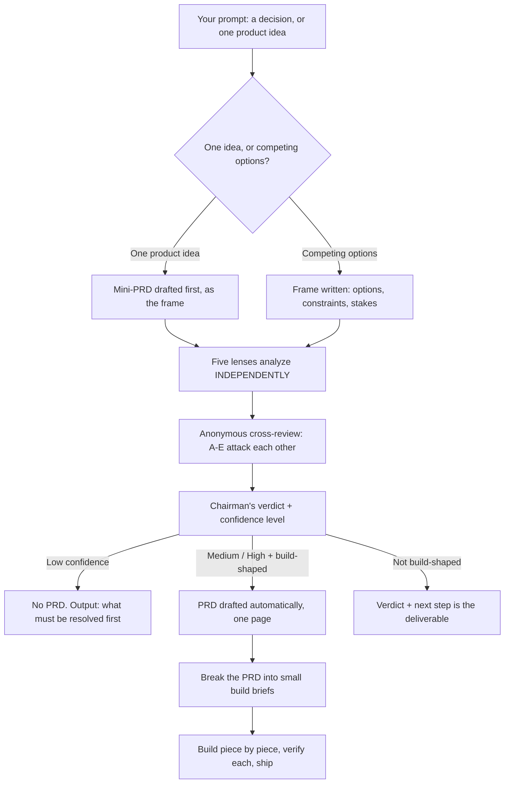

# council

Pressure-test a hard decision before you commit to it, then turn the
verdict into a buildable document automatically.

One answer from one model carries that model's blind spots. `council`
convenes five advisors that think in clashing ways, keeps them independent
so they cannot herd, has them review each other anonymously, and ends with
one synthesized verdict, and, when the verdict is solid enough, a PRD.

## The flow

Step by step:

1. **Frame.** The decision is restated in at most six lines: the question,
   the options, the hard constraints, the stakes. In the single-idea case,
   a one-page mini-PRD is drafted first and becomes the thing under review;
   the options become "ship as written", "ship smaller", "do not build".
2. **Independent analysis.** Five lenses (below) analyze the frame without
   seeing each other's work. Herding is the failure mode this step exists
   to prevent.
3. **Anonymous cross-review.** The lens names are stripped (A–E) and the
   advisors attack the set: strongest argument, weakest argument, factual
   weak spots, places where two advisors talk past each other.
4. **Verdict.** A chairman synthesizes, weighing arguments, never
   averaging votes, and reports: where they agree, where they clash, the
   recommendation, a confidence level (low / medium / high), the deciding
   factor, and the flip condition (what would have to be true for the
   other side to win).
5. **The PRD gate.** If confidence is **medium or high** and the winner is
   something to build, a one-page PRD is drafted on the spot: Problem,
   Target user, Decision recap, Scope in, Scope out, Core features (max 7),
   Constraints, Success criteria. If confidence is **low**, no PRD is
   written, a spec on top of a shaky verdict is fiction with headings ,
   and the output is the list of what must be resolved first. If the
   decision is not about building (pricing, timing, positioning), the
   verdict itself is the deliverable.
6. **After the PRD.** The PRD is broken into small, ordered build briefs
   (the vault's `small-briefs` skill), built piece by piece with
   verification per piece, then shipped. Decision to product, no gap.

## The five lenses

| Lens | Job |
|---|---|
| **Skeptic** | Assumes a fatal flaw exists and hunts for it |
| **Reframer** | Asks whether this is the right problem at all |
| **Opportunist** | Hunts the upside and adjacent wins everyone missed |
| **Operator** | Real cost, real time, skills on hand, reversibility |
| **Stranger** | Asks the plain outsider questions insiders stopped seeing |

## Two modes

- **Multi-model mode (preferred):** each lens is a genuinely different
  model, called directly, fast tiers are fine for advisors, the strongest
  model chairs. Diversity of models beats one model wearing five hats.
- **Single-model mode (fallback):** one agent runs the lenses in sequence,
  resetting between them. The verdict discloses which mode ran, and which
  models sat where.

A **lite form** (Skeptic, Reframer, Operator, no cross-review) exists for
smaller decisions. The agent picks the form by rule, cheap to reverse
means lite, expensive to be wrong means full, announces its pick in one
line, escalates to full on its own if the lite lenses disagree sharply,
and the user can always force either form with a word ("lite" / "full
council"). The PRD gate applies in both forms.

## When NOT to use it

Fact lookups, summaries, writing tasks, and choices with one obviously
right answer. The council is for decisions where being wrong is expensive.

## Install

Copy this folder into your agent's skills directory (for example
`~/.config/opencode/skills/council/`), then ask for a decision to be
pressure-tested: "council this", "should I X or Y", "pressure-test this
idea". The agent-facing instructions live in `SKILL.md`; this README is
the human explanation.

## Credits

Inspired by the LLM Council methodology popularized by Andrej Karpathy
(github.com/karpathy/llm-council) and Ole Lehmann's skill adaptation
(github.com/aiwithremy/claude-skills-llm-council). Neither source carries
an open license, so nothing is copied from them: the lenses, the
procedure, the PRD gate, and every word here are original to this repo.
