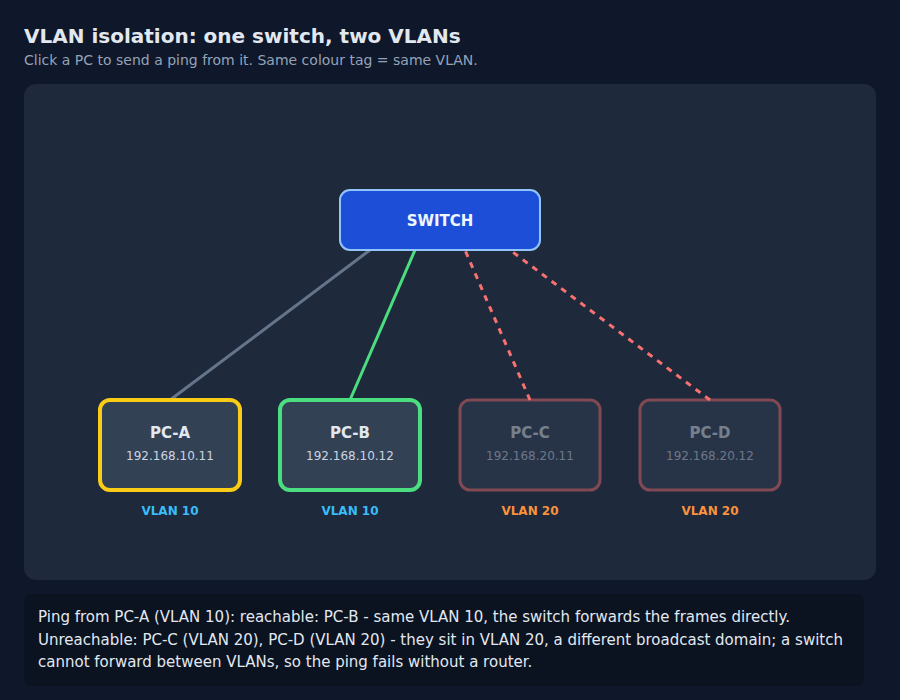

# Example: VLAN isolation figure

`vlan-isolation.html` is a finished figure built from this skill's
template (`../assets/figure-template.html`): one switch, four PCs,
PC-A and PC-B in VLAN 10, PC-C and PC-D in VLAN 20. Clicking a PC
sends a ping; the figure highlights the reachable PCs and the
readout names them, and names the unreachable ones with the reason
(different VLAN, different broadcast domain).

Verification (8 November 2026, scripted headless browser checks,
10 of 10 passed):

- Template: readout UP at rest, DOWN after clicking the link, UP
  again after reset.
- Ping from PC-A: readout reports PC-B reachable; PC-C and PC-D
  unreachable (VLAN 20). Highlight colors match (reachable green,
  unreachable dimmed, cables dashed red).
- Ping from PC-C: the mirror result (PC-D reachable, VLAN 10
  unreachable).
